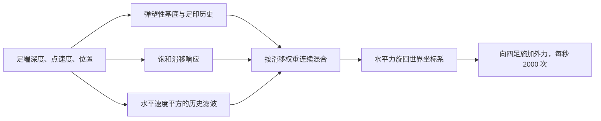

# M20 足端沙地代理模型：结构、标定、验证与训练

更新日期：2026-10-23。本文对应当前选择用于训练的 schema-2 足端模型。

## 1. 当前采用什么模型

当前代理是一个带内部状态的解析接触模型，不是神经网络。它分成两部分：

1. **弹塑性基底**：负责接近静止时的竖直承载、卸载、剪切松动和足印历史，由足端探针 MPM 数据标定。
2. **滑移响应**：根据整机 MPM 影子轨迹标定随深度变化的饱和水平阻力和有符号竖直阻尼，修正运动时的受力。

最终通过水平速度历史在两部分间连续混合。四足共享同一组本构参数，但每只足、每个环境有独立状态；同环境中的足端共享有限个足印槽位。

当前只计算四个 wheel 的接触力，顺序固定为：

```text
[fl_wheel, fr_wheel, hl_wheel, hr_wheel] = [左前, 右前, 左后, 右后]
```

本次整理保持当前部署 JSON **逐字节不变**，不改变受力公式、训练奖励、Actor/Critic 网络或观测动作维度。保留 schema-1 读取能力用于本流程的“基底标定中间产物”，并不依赖已经归档的旧版 `SandProxy` 程序。



## 2. 目录结构与职责

```text
src/M20_newton_training/
├── sand_proxy/                         # 训练所需的纯 Torch 运行时
│   ├── foot_model.py                   # FootSandModel；状态、基底、混合和重置
│   ├── shadow_response.py              # 饱和阻力与竖直阻尼
│   └── calibrated/m20_foot_sand.json    # 唯一默认部署参数，schema 2
└── tasks/m20/
    ├── mdp/foot_sand_proxy.py           # 取足端状态、坐标转换、施加外力
    ├── foot_sand_env.py                # 保证每个物理步都更新代理力
    └── config/M20/walk_on_sand_proxy_env_cfg.py

sand_proxy_lab/                         # 独立的离线标定/影子工具
├── calibration/
│   ├── __main__.py                     # plan / collect / fit-backbone / run / status
│   ├── config.py                       # 足端工况、轨迹、冻结参数、数据列定义
│   ├── common.py                       # USD 足端几何、粒子生成、参考沙面、配置哈希
│   ├── collect.py                      # 单足端 Newton MPM 采集
│   ├── data.py                         # 读取时处理已知重复末端记录
│   ├── foot_contact_fit.py             # 标定弹塑性基底并回放留出工况
│   └── plot_forces.py                  # 探针压入/拔出/前向/侧向曲线
├── shadow/
│   ├── __main__.py                     # Walk checkpoint 整机 MPM 影子实验
│   ├── random_agent.py                 # 无 checkpoint 的随机动作多回合实验
│   ├── record.py                       # 同步读取 MPM 冲量与代理预测，不施加代理力
│   ├── refit.py                        # 用单条连续影子轨迹标定滑移响应
│   ├── report.py / random_report.py    # 单轨迹 / 多回合受力统计与绘图
│   ├── episode.py                      # 无仿真地提取并分析单回合
│   ├── diagnostics.py                  # 原始样本散点、速度分组、深度/时间误差
│   └── compare_versions.py             # 同一条轨迹上对比基底和修正模型
├── validation/check_runtime.py         # 零动作支撑、有限值、施力频率检查
├── deploy.py                           # 发布最终候选，备份原部署文件
├── configs/m20_foot_intruder.json       # 现有 179 组探针的冻结配置参考
└── docs/                               # 本说明

output/sand_proxy/terrains/            # 按地形隔离，全部 Git 忽略
├── m20_sand_v1/                        # 当前已标定的地形
│   ├── intruder/                       # config.json、cases.json、179 个 foot_*.npz
│   ├── fit/
│   │   ├── backbone/                   # 基底拟合结果
│   │   ├── backbone_reference_v1/      # 先前基底报告与来源记录
│   │   └── contact/mpm_contact_v1/     # 当前完整模型的滑移修正拟合
│   ├── shadow/
│   │   ├── walk_forward_001/           # 当前滑移拟合源轨迹
│   │   ├── refit_validation_offset065/ # 独立新工况验证
│   │   └── random_30s_001/             # 原计划 30 s，已保存 7 s 后停止
│   │       └── episode_000_analysis/   # 完整首回合的 6 s 数据和分析
│   ├── validation/                    # 按需生成的训练接入检查
│   └── deployment_backups/            # 发布时保存的旧默认参数
└── <其他地形名>/                       # 各自包含 intruder/、fit/、shadow/ 等

archive/sand_proxy_legacy_20261023/      # 与现用流程隔离的封存资料
├── README.md
├── migration_manifest.json             # 每个历史路径对应的新路径/压缩包成员与原 SHA
├── SHA256SUMS
└── *.tar.gz                            # 旧代码、旧模型、旧数据和早期试验
```

训练不会导入 `sand_proxy_lab`，也不会从归档读取模型。离线工具通过公开的 `FootSandModel` 复用实际训练公式。旧路径没有建立兼容入口或软链接，后续统一使用新命令。

### 按地形选择目录

所有采集、拟合、绘图、接入检查和发布入口统一支持 `--terrain 地形名`，例如 `--terrain sand_soft_v1`。不指定时默认 `m20_sand_v1`；整机影子实验可从 `--model` 路径、滑移拟合可从 `--trace` 路径推断地形。单回合分析和版本对照默认跟随输入数据目录。

```bash
.venv/bin/python -m sand_proxy_lab.calibration plan --terrain sand_soft_v1
.venv/bin/python -m sand_proxy_lab.calibration collect --terrain sand_soft_v1
.venv/bin/python -m sand_proxy_lab.calibration fit-backbone --terrain sand_soft_v1
.venv/bin/python -m sand_proxy_lab.calibration status --terrain sand_soft_v1
```

上述命令的数据写入 `output/sand_proxy/terrains/sand_soft_v1/intruder/`，基底拟合结果写入同地形的 `fit/backbone/`。影子实验未显式指定 `--output-dir` 时，写入该地形的 `shadow/<时间戳>/`；滑移拟合写入 `fit/contact/<时间戳>/`。随机实验使用 `shadow/random_<时间戳>/`。

`--output-dir`、`--input-dir`、`--output` 等显式路径仍然可以覆盖默认路径。自定义探针数据目录不符合标准地形布局时，其基底结果仍保存在自定义目录的 `backbone_fit/`。

`--terrain` 只组织文件，不自动改变材料参数、机器人几何或训练默认部署模型。新地形必须冻结对应的物理配置；整机 MPM 参考场景应使用对应材料。训练仍读取唯一的默认部署 JSON，发布新地形模型后才切换。

## 3. 模型输入、坐标系与输出

### 3.1 几何与深度

足端使用 M20 USD 中实际的 capsule 碰撞体，半径约 **0.09 m**，中心线长度约 **0.054 m**；其原语局部旋转也从 USD 冻结。不能用外观网格尺寸代替碰撞体尺寸。

运行时采用世界竖直方向的最低点近似：

```text
z_min = z_center − radius − 0.5 × length × abs(capsule_axis_world.z)
d = H_reference − z_min
```

`d` 是**足底最低点的压入深度**，不是刚体原点深度。施力点的 XY 近似采用足端碰撞体中心 XY，Z 采用上述最低点。它不是完整的沙粒接触面求解。

参考沙面有三个不同来源：

| 场景 | 参考沙面 H |
|---|---|
| 独立探针标定 | 每个沙池沉降后测中心粒子柱顶中位数，再加半粒子间距 |
| 整机 MPM 影子实验 | 沙地沉降、机器人释放前测一次；本批数据约 0.293509 m |
| 代理训练 | 当前配置的固定虚拟沙面 0.40 m，加各环境原点 Z |

参考面在回合中不追踪局部凹坑或沙堆起伏。足印影响由模型内部历史近似表示。

### 3.2 速度与姿态

先从刚体质心速度得到近似施力点速度：

```text
v_point = v_COM + angular_velocity × (point − COM)
```

水平分量旋转到机身 **yaw 航向系**：X 为前向、Y 为侧向；Z 始终保持世界向上。模型计算完后再把水平力旋回世界系。这里没有把整个滚转/俯仰坐标系当成沙面法向。

内部四元数约定为 **xyzw**。阴影对照的 MPM 力是“沙地作用于机器人碰撞体的力”，不额外反转符号，也不减去机器人重力。

### 3.3 Torch API

| 参数 | 形状 | 含义 |
|---|---|---|
| `depth` | `[N,4]` | 足底压入深度，m |
| `velocity` | `[N,4,3]` | 航向系水平速度＋世界竖直速度，m/s |
| `positions_xy` | `[N,4,2]` | 世界 XY，用于共享足印记忆 |
| `dt` | 标量 | 本次真实受力更新时间，s |
| `stability_mass_kg` | 通常 `[N,1]` | 运行时稳定限制用有效质量，当前为整机质量/4 |
| 返回力 | `[N,4,3]` | 模型坐标系 Fx/Fy/Fz，N |

调用 `model.reset(env_ids)` 时，塑性深度、足印、滑移速度滤波、接触和腾空计时均重置；其他环境保留各自状态。

## 4. 当前受力函数

### 4.1 弹塑性基底 F_base

主要形式是正深度幂律及速度项：

```text
P(d) = a_p × d^n_p                         # 承载能力
K(d) = a_k × d^n_k                         # 卸载刚度
D_x/y(d,v_h) = a × d^n × (1 + b × v_h)     # 水平阻力幅值
```

结合塑性压入记忆，计算弹性压缩、向下压入阻尼、向上卸载阻尼和拔出拖曳；水平速度会使支撑随剪切距离衰减。X/Y 阻力沿水平速度反方向，并添加基于阻力的竖直抬升项。准确执行顺序以 `foot_model.py` 为准。

同环境保留 **16 个共享足印槽位**，默认残留比例 **0.7**。这些足印设置和低速正则化属于显式建模假设，不是从每条轨迹独立拟合的参数。基底标定范围为深度 0.20 m、速度 0.30 m/s。

### 4.2 滑移响应 F_slide

```text
Cx(d,vx) = cx × (1−exp(−d/dx)) / sqrt(1+(vx/satx)^2)
Cy(d,vy) = cy × (1−exp(−d/dy)) / sqrt(1+(vy/saty)^2)
Cz(d)    = cz × d^nz / (d^nz + dz^nz)
B(d)     = bearing × (1−exp(−d/db)) × exp(−d/soft)

F_slide = [−Cx×vx, −Cy×vy, B−Cz×vz]
```

水平力始终反向阻碍滑移。向下运动 `vz<0` 时竖直阻尼向上；向上运动时可以产生向下拖曳，因此负 Fz 本身不等于符号错误。运行时将阻尼系数限制在 `0.5×m_effective/dt` 以内。

### 4.3 平滑混合与历史

```text
alpha = exp(−dt/0.03)
s_next = alpha×s + (1−alpha)×(vx^2+vy^2)
g = 1−exp(−s_next/blend^2)
F = (1−g)×F_base + g×F_slide
```

离开沙面时 `s` 清零，`d<=0` 时不施力。持续零水平速度时逐渐回到基底承载；滑移时逐渐使用整机 MPM 修正响应。当前 `blend=0.05 m/s`，这一切换下限包含稳定性先验，不能仅由一条前进轨迹充分辨识。

### 4.4 参数标定方法

基底的承载/阻力使用带参数边界的幂律非线性最小二乘；卸载和剪切相关项根据拟合工况的完整准备、保持、测量历史估计。只读取 train 工况估计系数，validation 工况用于回放评估。

滑移阶段使用 `scipy.optimize.least_squares()`，共同估计 13 个参数：

```text
cx, dx, satx, cy, dy, saty, bearing, db, soft, cz, dz, nz, blend
```

损失为三轴预测误差除以各轴拟合段 RMS 后的平方和；每轴尺度至少为 5 N。归一化、参数估计均不读取验证段的目标力。四足共享参数，不把时间、足端编号、command 或策略动作作为拟合特征。

## 5. 现有数据与模型来源

### 5.1 足端探针数据

现用目录：`output/sand_proxy/terrains/m20_sand_v1/intruder/`，**179 组：114 train＋65 validation**。同目录的冻结配置保持原始内容，以便原 NPZ 的 `config_id` 仍能核验。历史冻结文件中的小腿几何、旧拟合节点字段仅作为原始元数据保留，当前足端流程不读取这些字段；新生成的配置不再创建旧分段拟合节点。

| 工况 | 采集方式 | 拟合组数 | 验证组数 |
|---|---|---:|---:|
| press | 从沙面上方连续压入到 20 cm，不重复采相同路径前缀 | 6 | 5 |
| pull | 先预压并保持，再按指定速度拔出 | 36 | 20 |
| forward | 固定深度，沿 +X 平移 8 cm | 36 | 20 |
| lateral | 固定深度，沿 +Y 平移 8 cm | 36 | 20 |

拟合深度节点：1、2、5、10、15、20 cm；速度：0.05、0.10、0.15、0.20、0.25、0.30 m/s。验证深度：3.5、7.5、12.5、17.5 cm；验证速度：0.075、0.125、0.175、0.225、0.275 m/s。粒子种子分别为 0 和 1。

探针姿态固定、角速度为零，实验只放足端碰撞体，不包含小腿。当前探针沙池 0.70×0.60×0.40 m，voxel=0.01 m、168000 粒子，dt=0.005 s，沉降 0.25 s，最大迭代 100。

每个 NPZ 有 `data` 和 JSON 字符串 `metadata`。`data` 的 18 列为：

```text
time, x, y, z, vx, vy, vz, angle_y, omega_y, depth, measure,
fx, fy, fz, tx, ty, tz, progress
```

位置/深度单位 m，速度 m/s，力 N，力矩 N·m。力矩关于探针刚体原点。`measure=1` 是正式动作阶段；预压和保持也保留，用来推进历史。读取时仅移除已知的重复末端记录，**原始 NPZ 不修改**。

### 5.2 整机 MPM 拟合轨迹

`shadow/walk_forward_001/` 使用 Walk `model_9999.pt`，指令 `(0.15,0,0)`，预热 0.5 s＋运动 4 s，共 **1800 个物理步**。MPM 沙池 2.4×2.4×0.3 m，voxel=0.02 m、216000 粒子；参考步长 0.0025 s，最大迭代 100。

当前滑移拟合使用时间 `t<=3.0 s` 的 **4731 个正深度足端样本**；3.0–3.2 s 排除，`t>=3.2 s` 的 520 帧、2080 个足端样本作为连续时间留出。该留出仍属于同一条轨迹。

### 5.3 独立验证

| 轨迹 | 是否参与滑移拟合 | 新模型 Fx/Fy/Fz RMSE |
|---|---|---|
| 初始 X 偏移 0.065 m、指令 0.10 m/s，预热后 1 s | 否 | 11.92 / 1.78 / 3.42 N |
| RandomAgent 第一回合，排除预热后的 5.5 s | 否 | 72.67 / 24.15 / 36.40 N |

随机第一回合只有 1.58% 状态超数值覆盖边界；向上运动时向下阻力偏大、水平饱和形状不完全匹配，是以后改结构和重新拟合的重点。当前按用户选择继续用现有模型训练。

`random_30s_001` 是当时计划名称，**实际只保存 7 s**，不能当成完成 30 s。第 0 回合完整 6 s，以超时结束、没有摔倒；第 1 回合只保存了部分。暂停的原进程已在目录迁移前关闭，没有恢复采集。完整第一回合分析位于 `episode_000_analysis/第一回合分析.md`。

## 6. 从头标定：完整操作步骤

所有命令均在项目根目录执行，使用项目已有 `.venv`。MPM 采集需要 CUDA；拟合、读数据、统计和绘图可以在 CPU 上完成。工具脚本自行选定 MPM 后端，不需要额外给脚本追加 `physics=...`。

### 第一步：冻结新材料与几何

如果要标定另一种材料，先设置实际 MPM 参考场景使用的 `SAND_MATERIAL` 等参数，再生成新的配置。探针 JSON 单独改了材料，不会自动改整机影子实验所用的 Sand 场景，两者应对应同一材料。

```bash
.venv/bin/python -m sand_proxy_lab.calibration plan \
  --terrain m20_material_new
```

首次生成会只读提取当前 M20 USD 足端、材料与数值设置，保存 `config.json` 和 179 个计划工况的 `cases.json`。后续使用同目录时默认读取已冻结配置，防止中途参数漂移。

只复现当前探针参数时，可以使用：

```bash
.venv/bin/python -m sand_proxy_lab.calibration plan \
  --config sand_proxy_lab/configs/m20_foot_intruder.json \
  --terrain m20_reproduce
```

### 第二步：试采后完成 179 组足端工况

```bash
# 先采一组验证采集链路
.venv/bin/python -m sand_proxy_lab.calibration collect \
  --terrain m20_material_new \
  --case foot_forward_d200_v300_train_s0

# 完整采集；已经完成且配置一致的工况会复用
.venv/bin/python -m sand_proxy_lab.calibration collect \
  --terrain m20_material_new

# 只查看进度，不运行物理
.venv/bin/python -m sand_proxy_lab.calibration status \
  --terrain m20_material_new
```

`--motion press/pull/forward/lateral` 和 `--split train/validation` 可用于分批采集。每个工况重新生成、沉降一个独立沙池；不是在受前一工况扰动的沙地上继续压入。NPZ 用临时文件加原子替换保存，可按工况续采；不支持从某个工况的中间物理步恢复。

### 第三步：拟合静态/历史承载基底

```bash
.venv/bin/python -m sand_proxy_lab.calibration fit-backbone \
  --terrain m20_material_new
```

默认产物是同一地形下的 `fit/backbone/proxy_model.json`（schema 1）、`report.json/md`、`manifest.json` 和 `validation.png`。这是**新流程的基底中间产物**，不会覆盖训练部署模型。

也可以用 `calibration run --terrain <地形名>` 一次完成全量采集和基底拟合；`run` 不接受部分工况筛选，以免把不完整的数据当成完整标定。

查看原始探针曲线：

```bash
.venv/bin/python -m sand_proxy_lab.calibration.plot_forces \
  --terrain m20_material_new
```

### 第四步：用基底模型采集整机 MPM 影子数据

```bash
.venv/bin/python -m sand_proxy_lab.shadow \
  --checkpoint logs/rsl_rl/deeprobotics_m20_walk/2026-10-21_19-37-26/model_9999.pt \
  --model output/sand_proxy/terrains/m20_material_new/fit/backbone/proxy_model.json \
  --command 0.15 0 0 --warmup 0.5 --duration 4 --viz none \
  --output-dir output/sand_proxy/terrains/m20_material_new/shadow/fit_source
```

机器人实际受到 MPM 的受力；基底代理只预测。采样在 MPM 求解入口读取同步后的碰撞体状态，求解出口把足端碰撞冲量除以物理 dt，得到同一窗口的真实平均力。托盘和其他机器人部位不计入足端目标，后者单独保存。

原始 `traces.npz` 包含时间、深度、施力点、足端速度、MPM/代理三轴力、COM 力矩、机身状态、动作、观测和模型覆盖标记；`model_snapshot.json` 保存本次真正使用的基底文件。这个快照是下一步的输入，不需要借用旧模型目录。前后对照工具也默认从轨迹自身的模型快照提取基底，不再保留一个单独的旧部署模型作为默认依赖。

### 第五步：拟合整机滑移修正

```bash
.venv/bin/python -m sand_proxy_lab.shadow.refit \
  --trace output/sand_proxy/terrains/m20_material_new/shadow/fit_source/traces.npz \
  --train-end 3.0 --validation-start 3.2 \
  --output-dir output/sand_proxy/terrains/m20_material_new/fit/contact/run_001
```

产物包括 schema-2 `proxy_model.json`、基底参数副本、`replay.npz`、分段误差报告及前后对比图。默认不发布。拟合器会从影子快照提取基底，避免对旧滑移修正反复叠加修正。

输入必须是单条连续回合，多回合文件会被拒绝。也可用随机回合做未来拟合数据，但必须先提取完整回合、检查状态覆盖，再设定合适的连续时间划分；现有随机第一回合目前仍是验证数据。

### 第六步：用未参加拟合的轨迹验证候选

```bash
# 改变初始位置和指令，验证候选仍然只做影子预测
.venv/bin/python -m sand_proxy_lab.shadow \
  --checkpoint logs/rsl_rl/deeprobotics_m20_walk/2026-10-21_19-37-26/model_9999.pt \
  --model output/sand_proxy/terrains/m20_material_new/fit/contact/run_001/proxy_model.json \
  --start-xy 0.065 0 --command 0.10 0 0 --duration 3 --warmup 0.5 \
  --output-dir output/sand_proxy/terrains/m20_material_new/shadow/validation --viz none

# 不加载任何 checkpoint 的 RandomAgent
.venv/bin/python -m sand_proxy_lab.shadow.random_agent \
  --model output/sand_proxy/terrains/m20_material_new/fit/contact/run_001/proxy_model.json \
  --duration 6 --warmup 0.5 --max-episode 6 --seed 45 \
  --output-dir output/sand_proxy/terrains/m20_material_new/shadow/random --viz none
```

RandomAgent 直接使用 IsaacLab 的 `create_random_action_policy()`：每 20 ms 对 16 个动作独立采样 U(-1,1)，动作仍经过任务既有位置/轮速缩放。每回合前 0.5 s 零动作预热。command 固定为零，不控制随机动作。

摔倒条件为机身倾斜超过 60°或机身距离参考沙面不足 0.20 m；接近池边（水平坐标绝对值超过 0.85 m）及回合时间上限也触发重置，原因分别统计。重置会恢复机器人、粒子位置速度、MPM/耦合求解器历史与代理历史，并重新沉降、测沙面。

`--duration` 包含各回合预热，不含沉降。长测可设为 30 s；这是仿真时长，墙钟时间可能长很多。新入口处理 Ctrl+C/SIGTERM 时先请求停止，再在控制步边界落盘、退出，不把用户停止记为求解器出错。重新运行使用新输出目录，不从保存的受力记录直接恢复 MPM 粒子状态。

整机场景的粒子扰动种子由 spawner 固定；**仅换 `--seed` 不能保证换了沙粒排列**。改变起始位置、指令或动作策略比单改种子更能检验新状态。

### 第七步：纯 CPU 重画和单回合分析

```bash
# Walk 单轨迹报告
.venv/bin/python -m sand_proxy_lab.shadow \
  --analyze output/sand_proxy/terrains/m20_material_new/shadow/validation/traces.npz

# RandomAgent 多回合报告
.venv/bin/python -m sand_proxy_lab.shadow.random_agent \
  --analyze output/sand_proxy/terrains/m20_material_new/shadow/random/traces.npz

# 从当前已保存的随机数据提取首回合，写入一个新目录并生成诊断图
.venv/bin/python -m sand_proxy_lab.shadow.episode \
  --trace output/sand_proxy/terrains/m20_sand_v1/shadow/random_30s_001/traces.npz --episode 0 \
  --output-dir output/sand_proxy/terrains/m20_sand_v1/shadow/random_30s_001/episode_000_reanalysis

# 同一条轨迹对照基底与修正后的预测，不再运行 MPM
.venv/bin/python -m sand_proxy_lab.shadow.compare_versions \
  --trace output/sand_proxy/terrains/m20_sand_v1/shadow/refit_validation_offset065/traces.npz
```

单回合提取会在派生数据中把时间和编号重新从零开始，并保留原回合编号及源 SHA。受力数组不改，源 NPZ 不改。曲线采用策略窗口内 `ΣFdt/Σdt`，误差使用全部原始物理步；不会平移时间轴或用平滑结果替代原始误差。

### 第八步：发布候选与检查训练接入

```bash
.venv/bin/python -m sand_proxy_lab.deploy \
  --model output/sand_proxy/terrains/m20_material_new/fit/contact/run_001/proxy_model.json

.venv/bin/python -m sand_proxy_lab.validation.check_runtime \
  --num-envs 4 --steps 250 --terrain m20_material_new \
  --output output/sand_proxy/terrains/m20_material_new/validation/runtime_support.json
```

发布时会从候选路径推断所属地形，也可以显式指定 `--terrain`。发布器要求候选是 schema 2 且三轴连续留出 RMSE 均相对基底改善；它把原部署文件备份到 `output/sand_proxy/terrains/<地形名>/deployment_backups/`，再原子替换默认 JSON。该自动条件只是开发回放条件，不代表独立随机动作误差一定小，应结合上一阶段报告选择模型。也可以在 `shadow.refit` 时指定 `--deploy` 合并拟合和发布。

接入检查确认有限值、零动作支撑、没有重置、足端没有落到底板，以及**实际模型更新次数等于策略步数×decimation**。当前模型已做过 4 环境、5 s 支撑检查，以及 2 次 PPO 更新短测；这些是接入检查，不是策略收敛结论。

## 7. 直接使用当前模型训练

当前模型已经部署，不需要为了开始训练重新执行第 6 节的采集、拟合和发布。

```bash
.venv/bin/isaaclab train --rl_library rsl_rl \
  --task M20NewtonTraining-M20-M20-WalkOnSandProxy \
  --num_envs 64 --logger tensorboard --viz none physics=newton_mjwarp

.venv/bin/tensorboard \
  --logdir logs/rsl_rl/deeprobotics_m20_walk_on_sand_proxy --port 6006
```

沿用 Walk 权重进行微调时，在训练命令中追加实际 checkpoint，例如：

```bash
--checkpoint logs/rsl_rl/deeprobotics_m20_walk/2026-10-21_19-37-26/model_9999.pt \
--no-resume_optimizer_state
```

代理训练使用 **plain Newton MJWarp**，不用 MPM 粒子；`newton_sand` 是真实 MPM 任务/影子实验的参考后端，不能与代理力重复施加。

当前训练接口为 actor 57 维、critic 60 维、动作 16 维，沿用 Walk 的 `[512,256,128]` 网络。代理的 ActionTerm 为 0 维，只附加物理外力，不占策略动作槽位；没有新增接触力观测。

`WalkOnSandProxy` 采用精简的 16 项奖励。当前禁用 `contact_forces` 超限惩罚、HipY/Knee 默认姿态惩罚、轮加速度惩罚 `joint_acc_wheel_l2` 和动作二阶平滑惩罚 `action_smooth_l2`；此前关闭的 `joint_mirror`、`stand_still`、`feet_slide_ang_z_cmd`、非足端接触惩罚及 `sand_diagonal_steps`、`sand_step_completion` 保持关闭。这里只停用奖励项，实际施加的沙地代理力、接触状态及腾空计时仍正常工作。保留速度跟踪、抬腿和交替步态、机身稳定、腿关节力矩/加速度、动作一阶变化及轮速约束。

HipX 默认姿态惩罚权重从 **−0.5 调为 −1.5**，并加入两项专用约束：

- `hipx_symmetry`：权重 **−0.5**。明确按 FL、FR、HL、HR 顺序解析 HipX 关节，原始误差为 `((q_FL+q_FR)^2+(q_HL+q_HR)^2)/2`，单位为 rad²。当前 M20 左右 HipX 有效轴同向，因此几何镜像对应相反角度。直行和零指令使用完整惩罚；`|vy|>0.05 m/s` 或 `|wz|>0.1 rad/s` 时乘 **0.25**，允许侧移、转向时的必要非对称。
- `diagonal_lift_consistency`：权重 **−3**，状态类 `ProxyDiagonalLiftConsistency`。记录每脚相对本次摆腿开始时最后支撑位置的峰值抬升，A=(FL,HR)，B=(FR,HL)。两组都完成一次有效摆腿后，计算组内差 `E_in=((H_FL-H_HR)^2+(H_FR-H_HL)^2)/2` 和组间差 `E_between=(mean(H_A)-mean(H_B))^2`，原始惩罚为 `min((E_in+E_between)/0.25^2,4)`。只结算一次，然后消费两组记录；不将同一时刻的支撑脚和摆动脚高度比较。有效摆腿必须在相反对角组支撑时开始，计时至少 **0.1 s**（沿用包含落足采样间隔的约定），且不能出现四脚同时卸载；重置后的首次下落不作为摆腿。等待另一组的记录超过 **2 s** 后丢弃，防止陈旧高度参与比较。指令模长保持 ≥0.1 时，改变方向不清空记录；低于 0.1 或环境重置时逐环境清空。两组分别抬升 25 cm、5 cm 且组内一致时，原始惩罚为 **0.64**，最终该周期事件为 `−3×0.64×0.02=−0.0384`；两组都抬升 15 cm 时为零。绝对抬升目标仍由 `rotation_gait_status` 保证，单独的高度一致性惩罚不能保证抬得足够高。

迈步接触相关项当前启用：`feet_air_time` **+5**、`rotation_gait_status` **+10**、`rotation_gait_symmetry` **+3**，实现集中在 `mdp/proxy_contact_rewards.py`；`feet_slide_ang_z_cmd` 已禁用。腾空奖励及两项对角步态奖励统一按世界坐标系代理竖直力 **Fz > 5 N** 判断为接触，**Fz ≤ 5 N** 累计无承载时间，包含负的拔出力；不取绝对值，水平阻力不影响腾空判定。`contact_forces` 超限惩罚当前已关闭。接触/腾空计时与落足事件检测均按 **50 Hz** 更新：每 20 ms 读取该控制周期最后一次施加的代理力，比较相邻控制步的竖直接触状态；不累计周期内部的高频接触切换，每只脚每控制步最多一次落足。重置后的首次落地仍不计腾空奖励。物理代理力保持 **2000 Hz** 更新。腾空项采用 **0.1 s** 阈值、**1.0 s** 上限：落足时得分为 `min(腾空时间, 1.0) - 0.1`，不足 0.1 s 扣分；**仅在完整速度指令模长 `sqrt(vx²+vy²+wz²) ≥0.1` 时启用**，仍仅在落足事件时结算；低于 0.1 时正奖励和短腾空扣分均为零。侧移 ×2、转向 ×3、同时侧移转向 ×4 的放大系数保留，`command_threshold=0.1` 仅用于选择倍率，不控制奖励是否启用。两项 `rotation_gait_*` 奖励和 `diagonal_lift_consistency` 同样使用 `min_command_norm=0.1`；直行、后退、侧移、纯转向和混合指令均可启用，模长恰好 0.1 时启用，零指令禁用。该门控判断的是指令，不是实际机身速度。HipX 默认姿态、左右 HipX 镜像及机身稳定惩罚保留，物理代理力和接触计时不停止。重复方向腾空项保持关闭，避免同一次落足重复计奖。非足端 `undesired_contacts` 仍关闭，因为模型没有其他部位的代理力。真实 MPM 的 `WalkOnSand` 奖励不变。

对角步态两项保留原 `rotation_gait_*` 名称，采用以下规则，均按 50 Hz 结算：

- `rotation_gait_status`：权重 **+10**，实现为状态类 `ProxyRotationGaitStatus`。A 组为左前＋右后，B 组为右前＋左后；一组两脚都承重（Fz > 5 N），另一组两脚都卸载（Fz ≤ 5 N）时才计分。逐脚记录最近的支撑位置，使用足端胶囊最低点相对该位置的世界 Z 抬升量，而非刚体原点的组间平均高度差。每脚抬升量除以 **0.25 m** 后截断到 [0,1]，摆动组取两脚较小值。**25 cm 是相对各自最后支撑位置的抬升目标，不是高于沙面的净空高度，也不是开始计分的硬阈值**；较小抬升仍按比例计分。只奖励该次摆动中新增加的最高进度，悬停、降下后重访已计分高度不会重复得分；摆动组两脚均重新承重后开始新的进度周期。每组每次摆动的原始进度奖励总和最多为 1，RewardManager 仍乘权重与 0.02 s。
- `rotation_gait_symmetry`：权重 **+3**，采用 **1.0 s** 滑动窗口。A 状态严格要求 A 两脚支撑、B 两脚卸载；B 状态反之。两种状态的窗口占比分别为 p_A、p_B，原始奖励为 **2√(p_A p_B)**；未填充的窗口槽位为零，自然预热。固定单一对角支撑、固定前腿支撑后腿卸载、四足同时接触/同时卸载均为零分；短暂四足支撑可占用窗口，但不作为有效对角状态计分。
- 环境重置或指令模长低于 0.1 时，逐环境清空 `rotation_gait_status`、`rotation_gait_symmetry` 和 `diagonal_lift_consistency` 的支撑锚点、最高进度、窗口及待比较记录。模长始终 ≥0.1 时切换直行、侧移、转向或改变转向符号保留历史。重新启用后高度项需要重新观察支撑，对称窗口重新预热，避免旧步态记录直接产生得分或扣分。物理代理力、通用接触计时及网络接口保持不变。

当前代理任务同时禁用 `joint_mirror` 和 `stand_still`。Walk 与真实 MPM WalkOnSand 的转向奖励配置保持原样。

物理 dt **0.0005 s**，代理力 **2000 Hz** 更新；策略 dt **0.02 s**，decimation **40**。`FootSandProxyEnv` 禁止 Newton 把整个策略周期折成一次外力更新。这是当前显式阻尼稳定使用所需的接入方式，不能只改 dt 而让力仍然每 20 ms 更新一次。

当前 command 范围为前向 ±0.8 m/s、侧向 ±0.2 m/s、转向 ±0.6 rad/s。代理沙面为各环境原点上方 **0.30 m**，底部刚性平面为 z=0；机器人根部初始 z 为 **0.88 m**，距参考沙面仍为 **0.58 m**，可视沙面中心为 **0.298 m**。可选的 `proxy_depth_limit` 下陷终止当前未启用，不能把 JSON 中的建议阈值视为正在生效的终止条件。JSON 的 0.28 m 仍是修正模型的统计深度覆盖标记，较深输入继续沿用已有模型的深度限幅；本次奖励修改不改变标定参数、沙面高度或重置条件。

## 8. 当前边界与后续维护

| 项目 | 当前设置 |
|---|---|
| 基底深度/速度范围 | 0.20 m / 0.30 m/s |
| 修正模型深度统计上限 | 0.28 m |
| 水平速度模长覆盖标记 | 2.6 m/s |
| 竖直速度绝对值覆盖标记 | 0.60 m/s |
| 侧向速度绝对值覆盖标记 | 0.18 m/s |
| 代理沙面 / 机器人初始根部高度 | 0.40 m / 0.98 m（相对环境原点） |
| 训练下陷终止 | 0.30 m（任务配置覆盖 JSON 默认值） |
| 运行时力更新 | 2000 Hz |
| 未建模接触部位 | 小腿、大腿、机身 |

覆盖边界来自现有轨迹，不能当成整个深度×速度矩形都被充分采样。修改材料或足端碰撞几何后，需要重新采集和拟合对应系数；相同结构的代码可以继续用，参数不应直接当作新材料的标定结果。

后续改受力结构时，保持现有模型为训练基线，新候选放入新的 `fit/<名称>/`，新数据放入新的 `intruder/` 或 `shadow/` 子目录；未发布候选不会影响默认训练参数。若用现有随机回合重新拟合，应另采新回合保留独立验证用途。

## 9. 旧版本归档与可追溯性

旧的旋转/滚动工况模型、v2 分段受力场、v3 主受力多项式及对应程序已封存；本次不再使用的小腿数据、旧探针批次、失败候选和重复/短测轨迹也在归档包中。所需的 179 组足端原始数据及当前模型的拟合/验证轨迹留在现用工作区。

本次地形归并另外保存 `sand_proxy_lab/docs/地形目录迁移.json`，记录归并前后路径与校验值。归档按文件校验后才从原入口移走；`migration_manifest.json` 记录旧路径、新路径或压缩包内成员名和原始 SHA256。原始 NPZ、模型快照及既有 JSON 报告中的历史绝对路径有意保留，以免改变来源哈希；找现位置时使用迁移清单，而不是把历史路径当作当前命令。

归档数据包及 `output/` 默认被 Git 忽略；现用代码、配置、部署参数和本文可正常提交。归档中可读的索引及校验清单可随代码保存。重新发布产生的备份写入 `output/sand_proxy/terrains/<地形名>/deployment_backups/`，不修改已封存的历史包。

当前部署参数 SHA256：

```text
2eca9c13dc0c806a674a8fcdceaea2a24ce366e962e37c8dbf2c5c2e1c70f34e
```

## 附录：当前滑移分支的 13 个参数

以下为本次保持不变的部署值，参数名对应 `shadow_contact.coefficients`。

| 参数 | 值 |
|---|---:|
| `cx` | 707.0651902 |
| `dx` | 0.09000000357 |
| `satx` | 0.3631651827 |
| `cy` | 691.4673152 |
| `dy` | 0.02842963031 |
| `saty` | 20 |
| `bearing` | 14.56277039 |
| `db` | 0.009029664892 |
| `soft` | 0.2352730555 |
| `cz` | 854.7951922 |
| `dz` | 0.005649491933 |
| `nz` | 1.126694608 |
| `blend` | 0.05 |

`dx/dy/dz/db/soft` 为长度尺度，`satx/saty/blend` 为速度尺度，`nz` 为无量纲指数；系数的组合按第 4 节公式得到 N。基底参数、几何、材料、历史设置、拟合来源及既有验证结果均直接保存在部署 JSON 中。

## 附录：本批 MPM 材料快照

这些值来自当前模型的 `material` 元数据；代理运行时不求解颗粒材料方程，受力由前述拟合系数决定。

| 材料字段 | 值 |
|---|---:|
| `density` | 1700 |
| `young_modulus` | 1e+15 |
| `poisson_ratio` | 0.3 |
| `viscosity` | 0 |
| `friction` | 0.7 |
| `damping` | 0.005 |
| `yield_pressure` | 1e+12 |
| `tensile_yield_ratio` | 0 |
| `yield_stress` | 0 |
| `hardening` | 0 |
| `dilatancy` | 0 |
| `hardening_rate` | 1 |
| `softening_rate` | 1 |
